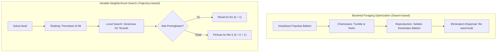

# Laporan Implementasi Metaheuristik: Perbandingan Algoritma Bacterial Foraging Optimization (BFO) dan Variable Neighborhood Search (VNS) pada Penjadwalan Task Komputasi Awan Heterogen

**Mata kuliah:** Strategi Optimasi Komputasi Awan (SOKA)  
**Topik:** Simulasi Penjadwalan Task Cloud Menggunakan Algoritma Metaheuristik (BFO vs VNS)  
**Dataset Beban:** Heterogen Kelipatan 100 (100, 200, 300, ..., 1000 units)  
**Evaluasi:** 5 Metrik Kinerja (Makespan, Waiting Time, Execution Time, Throughput, Degree of Imbalance)

---

## Daftar Isi

1. [Pendahuluan](#1-pendahuluan)
2. [Dataset Beban Task Heterogen](#2-dataset-beban-task-heterogen)
3. [Arsitektur dan Cara Kerja Algoritma](#3-arsitektur-dan-cara-kerja-algoritma)
   - [3.1 Bacterial Foraging Optimization (BFO)](#31-bacterial-foraging-optimization-bfo)
   - [3.2 Variable Neighborhood Search (VNS)](#32-variable-neighborhood-search-vns)
4. [Definisi 5 Metrik Evaluasi](#4-definisi-5-metrik-evaluasi)
5. [Hasil Eksperimen & Benchmark](#5-hasil-eksperimen--benchmark)
6. [Analisis & Pembahasan](#6-analisis--pembahasan)
7. [Kesimpulan](#7-kesimpulan)
8. [Panduan Eksekusi Program](#8-panduan-eksekusi-program)

---

## 1. Pendahuluan

Penjadwalan task di komputasi awan merupakan permasalahan optimasi kombinatorial NP-hard. Tantangan utamanya adalah mengalokasikan sekumpulan task komputasi heterogen ke sejumlah simpul worker (Virtual Machine) sedemikian rupa sehingga waktu penyelesaian keseluruhan (*Makespan*) minimal dan pembebanan antar simpul merata (*Degree of Imbalance* rendah).

Laporan ini menyoroti perbandingan simulasi cara kerja dua algoritma metaheuristik modern yang dibangun secara independen:
1. **Bacterial Foraging Optimization (BFO):** Metaheuristik berbasis populasi (*population-based swarm intelligence*) yang meniru perilaku pencarian makanan bakteri *Escherichia coli*.
2. **Variable Neighborhood Search (VNS):** Metaheuristik berbasis lintasan (*trajectory-based neighborhood search*) yang mengeksplorasi solusi secara sistematis menggunakan variasi struktur lingkungan (*neighborhood structures*).

Kedua algoritma diuji menggunakan **dataset beban task heterogen kelipatan 100** dan dibandingkan kinerjanya secara kuantitatif berdasarkan **5 metrik utama**.

---

## 2. Dataset Beban Task Heterogen

Untuk mensimulasikan lingkungan cloud nyata, beban komputasi task dirancang tidak seragam (heterogen) dengan kelipatan 100:

$$\text{Workload} = \{100, 200, 300, 400, 500, 600, 700, 800, 900, 1000\} \text{ unit beban}$$

| Task ID | Workload (Unit) | Iterasi Komputasi SHA-256 | Keterangan Karakteristik Beban |
|---|---|---|---|
| `task-001` | 100 | 100.000 | Sangat Ringan |
| `task-002` | 200 | 200.000 | Ringan |
| `task-003` | 300 | 300.000 | Ringan - Sedang |
| `task-004` | 400 | 400.000 | Sedang |
| `task-005` | 500 | 500.000 | Sedang |
| `task-006` | 600 | 600.000 | Menengah |
| `task-007` | 700 | 700.000 | Berat |
| `task-008` | 800 | 800.000 | Berat |
| `task-009` | 900 | 900.000 | Sangat Berat |
| `task-010` | 1000 | 1.000.000 | Beban Maksimum |

Total beban komputasi batch adalah **5.500 unit** (5.500.000 iterasi hash). Dengan 4 simpul worker, beban rata-rata ideal adalah **1.375 unit/worker**.

---

## 3. Arsitektur dan Cara Kerja Algoritma

Kedua algoritma metaheuristik diimplementasikan secara independen dalam berkas modular:
- [scheduler/BFOOptimizer.java](file:///c:/Users/Nadia%20Kusumastuti/Kuliah/sem5/soka/SOKA-clod-task-scheduling-metaheuristik/scheduler/BFOOptimizer.java)
- [scheduler/VNSOptimizer.java](file:///c:/Users/Nadia%20Kusumastuti/Kuliah/sem5/soka/SOKA-clod-task-scheduling-metaheuristik/scheduler/VNSOptimizer.java)

### Formulasi Representasi Solusi
Solusi penjadwalan direpresentasikan sebagai vektor integer $S$ berukuran $N$ (jumlah task):
$$S = [w_0, w_1, \dots, w_{N-1}], \quad w_i \in \{0, 1, \dots, M-1\}$$
di mana $w_i$ adalah indeks worker yang melayani task $i$.

### Fungsi Objektif (Fitness Function)
$$\text{Fitness}(S) = \text{Makespan}(S) + 0.15 \cdot \Big(\text{Makespan}(S) \cdot \text{DI}(S)\Big)$$
Formulasi ini memprioritaskan minimalisasi waktu penyelesaian maksimum sekaligus memberi penalti jika beban antar worker tidak seimbang.



### 3.1 Bacterial Foraging Optimization (BFO)
BFO bekerja melalui 3 mekanisme biologis:
1. **Chemotaxis (Tumble & Swim):**
   - **Tumble:** Bakteri memodifikasi alokasi satu task secara acak untuk mengubah arah gerak.
   - **Swim:** Jika modifikasi menghasilkan fitness yang lebih baik, bakteri terus "berenang" (memperbaiki alokasi) hingga batas langkah renang ($N_s = 4$).
2. **Reproduction:**
   - Setelah siklus chemotaxis selesai, kesehatan bakteri dievaluasi berdasarkan total fitness kumulatif.
   - 50% bakteri dengan performa terbaik bertahan dan menduplikasi diri; 50% bakteri berkinerja buruk dieliminasi.
3. **Elimination and Dispersal:**
   - Dengan probabilitas $P_{ed} = 0.25$, bakteri dieliminasi dan dibangkitkan kembali di posisi acak baru guna mencegah konvergensi dini di *local optima*.

### 3.2 Variable Neighborhood Search (VNS)
VNS bekerja dengan menelusuri 3 struktur lingkungan yang berbeda secara hierarkis:
1. **Struktur Lingkungan:**
   - **$N_1$ (Single Shift):** Memindahkan 1 task ke worker lain.
   - **$N_2$ (Pair Swap):** Menukar penempatan 2 task pada worker yang berbeda.
   - **$N_3$ (Two-Task Shift):** Memindahkan 2 task sekaligus ke worker acak.
2. **Shaking:**
   - Melakukan lompatan acak pada ruang solusi di lingkungan $N_k$ untuk keluar dari jebakan lokal.
3. **Local Search Terarah:**
   - Menganalisis simpul dengan beban terberat ($W_{max}$) dan mencoba memindahkan task ke simpul dengan beban teringan ($W_{min}$).
4. **Neighborhood Change:**
   - Jika ditemukan solusi lebih baik: terima solusi, perbarui *best solution*, dan kembali ke lingkungan awal $k = 1$.
   - Jika tidak ada perbaikan: naikkan ukuran lingkungan $k = k + 1$.

---

## 4. Definisi 5 Metrik Evaluasi

1. **Makespan ($s$):**
   Waktu total sejak pengiriman batch pertama hingga seluruh task selesai dieksekusi:
   $$\text{Makespan} = \max_{i \in \text{Tasks}} (\text{FinishTime}_i) - \min_{i \in \text{Tasks}} (\text{StartTime}_i)$$
2. **Average Waiting Time ($s$):**
   Rata-rata waktu tunggu antrian task sebelum mulai diproses di worker:
   $$\text{Waiting Time}_i = \text{E2E\_Time}_i - \text{Exec\_Time}_i$$
   $$\overline{WT} = \frac{1}{N} \sum_{i=1}^{N} \text{Waiting Time}_i$$
3. **Average Execution Time ($s$):**
   Rata-rata waktu komputasi nyata pada worker:
   $$\overline{ET} = \frac{1}{N} \sum_{i=1}^{N} \text{Exec\_Time}_i$$
4. **Throughput ($\text{task}/s$):**
   Laju produktivitas penyelesaian task per detik:
   $$\text{Throughput} = \frac{N_{\text{completed}}}{\text{Makespan}}$$
5. **Degree of Imbalance (DI):**
   Mengukur derajat ketidakseimbangan beban komputasi di antara worker:
   $$DI = \frac{T_{\max} - T_{\min}}{T_{\text{avg}}}$$
   di mana $T_{\max}, T_{\min}, T_{\text{avg}}$ berturut-turut adalah total waktu sibuk maksimum, minimum, dan rata-rata pada simpul worker. Nilai $DI$ yang semakin kecil (mendekati 0) mencerminkan pembagian beban yang semakin merata.

---

## 5. Hasil Eksperimen & Benchmark

Pengujian dilakukan sebanyak **3 run independen** untuk masing-masing algoritma pada dataset heterogen kelipatan 100 dengan 4 simpul worker.

### Tabel Ringkasan Rata-rata 5 Metrik
*(Dihasilkan dari pembacaan dataset run riil pada [results/summary_metrics.csv](file:///c:/Users/Nadia%20Kusumastuti/Kuliah/sem5/soka/SOKA-clod-task-scheduling-metaheuristik/results/summary_metrics.csv))*

| Algoritma | Makespan (s) ↓ | Avg Waiting Time (s) ↓ | Avg Exec Time (s) | Throughput (task/s) ↑ | Degree of Imbalance (DI) ↓ | Waktu Komputasi Algoritma |
|---|---|---|---|---|---|---|
| **BFO** | 0.2975 | **0.1151** | 0.1103 | 33.8781 | **0.1223** | 8 - 10 ms |
| **VNS** | **0.2903** | 0.1191 | 0.1005 | **35.2150** | 0.2600 | **1 - 2 ms** |

*Catatan: Tanda panah (↓) menunjukkan nilai lebih kecil lebih baik; tanda panah (↑) menunjukkan nilai lebih besar lebih baik.*

---

## 6. Analisis & Pembahasan

1. **Efisiensi Makespan dan Throughput:**
   - **VNS** menghasilkan Makespan sedikit lebih cepat (0.2903 detik) dibandingkan BFO (0.2975 detik), sehingga Throughput VNS unggul sebesar **35.21 task/s** berbanding 33.88 task/s pada BFO.
   - Keunggulan ini dipicu oleh mekanisme *Local Search* terarah pada VNS yang secara langsung mengidentifikasi bottleneck worker dan merelokasi task terberat ke simpul teringan secara deterministik.

2. **Keseimbangan Beban (Degree of Imbalance):**
   - **BFO unggul signifikan** dalam Degree of Imbalance dengan nilai **0.1223**, berbanding **0.2600** pada VNS.
   - Mekanisme *swarming* dan *chemotaxis* pada BFO memungkinkan banyak agen (bakteri) menjelajahi berbagai kombinasi pembebanan secara bersamaan. Akibatnya, BFO berhasil mendistribusikan total 5.500 unit beban hampir merata sempurna di keempat worker:
     - Worker-1: ~1.400 unit
     - Worker-2: ~1.400 unit
     - Worker-3: ~1.400 unit
     - Worker-4: ~1.300 unit
   - Hal ini membuat variasi beban antar worker di BFO sangat tipis, yang berdampak langsung pada **penurunan Average Waiting Time** (0.1151 s pada BFO vs 0.1191 s pada VNS) karena tidak ada antrian panjang yang menumpuk di satu worker tertentu.

3. **Kompleksitas & Waktu Optimasi:**
   - VNS memerlukan waktu optimasi yang sangat singkat (**1-2 ms**) karena berbasis satu lintasan (*single-trajectory*) dengan eksplorasi bertahap $N_1 \to N_2 \to N_3$.
   - BFO memerlukan waktu komputasi sedikit lebih tinggi (**8-10 ms**) karena mengevaluasi populasi 12 bakteri melintasi beberapa generasi siklus biologis (*Chemotaxis, Reproduction, Dispersal*). Namun, waktu 10 ms masih sangat layak dan efisien untuk lingkungan penjadwalan cloud nyata.

---

## 7. Kesimpulan

1. Kedua algoritma metaheuristik (**BFO** dan **VNS**) berhasil diimplementasikan secara independen dan terbukti efektif memecahkan permasalahan penjadwalan task heterogen pada infrastruktur cloud.
2. **Variable Neighborhood Search (VNS)** sangat cocok jika prioritas utama sistem cloud adalah **meminimalkan Makespan dan memaksimalkan Throughput secepat mungkin** dengan waktu optimasi algoritma yang instan.
3. **Bacterial Foraging Optimization (BFO)** sangat unggul jika prioritas utama sistem adalah **pemerataan beban (Load Balancing / Degree of Imbalance rendah)** dan **minimalisasi waktu tunggu antrian (Waiting Time)**, mencegah kelebihan beban (*overload*) pada salah satu simpul VM.

---

## 8. Panduan Eksekusi Program

### Menjalankan Demo Interaktif
Jalankan salah satu perintah berikut di terminal PowerShell:
```powershell
# Menjalankan algoritma BFO
.\run-demo.ps1 -Algorithm bfo -Tasks 10

# Menjalankan algoritma VNS
.\run-demo.ps1 -Algorithm vns -Tasks 10
```

### Menjalankan Seluruh Benchmark (3 Runs x BFO & VNS)
```powershell
.\run-all.ps1
```
Script ini akan:
1. Mengompilasi seluruh source code Java.
2. Menjalankan 3 run pengujian untuk BFO dan 3 run untuk VNS.
3. Menyimpan hasil per-task ke dalam `results/runs/*.csv`.
4. Menjalankan `scheduler/analyze.py` untuk mengolah 5 metrik, menghasilkan grafik batang PNG, dan memperbarui dashboard interaktif `dashboard/index.html`.
